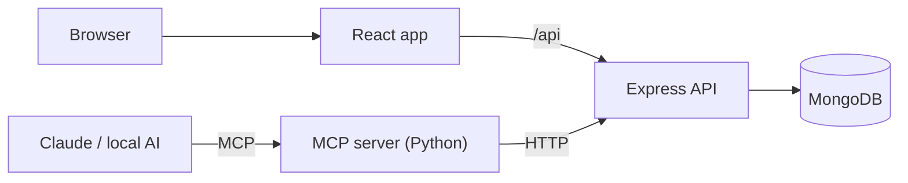

# Task Manager

> A web todo list that an AI can drive through an **MCP** server.


## About

A task manager with categories, nested subtasks and drag and drop. Alongside the website, an
**MCP server** lets an AI (Claude, or a local model) list, create, update and delete tasks.



The website and the MCP server both go through the Express API; only the API talks to MongoDB.
Every API request requires a Bearer token (`API_TOKEN`).

## Stack

| Part | Tech |
|---|---|
| **Front end** | React 19, TypeScript, Vite, `@dnd-kit/core`, axios |
| **Back end** | Node.js, Express 5, Mongoose, TypeScript (run directly by Node, no build step) |
| **Database** | MongoDB |
| **MCP server** | Python 3.12, `uv`, `mcp` SDK (FastMCP), httpx, Streamable HTTP transport |
| **Tests** | Postman CLI (API + MCP collections), Vitest, Testing Library |

## Features

- Custom categories: create, rename, reorder by drag and drop
- **Subtasks of unlimited depth**: nest a task by dropping it on another one, move whole subtrees
- Reorder tasks within a list or across columns
- Checking a task checks its whole subtree; a `Done` column collects finished tasks
- Light / dark theme, mobile friendly

### MCP tools

| Tool | Purpose |
|---|---|
| `get_tasks` | List tasks |
| `create_task` | Create a task or a subtask |
| `update_task` | Rename, check, change category, move, reorder |
| `delete_task` | Delete a task and its subtasks |
| `get_categories` / `update_category` | List, rename, reorder categories |
| `get_category_task` / `delete_category_task` | A category's tasks, clear a category |

## Project structure

```
task_manager/
├── frontend/   # React app (Vite)
├── backend/    # Express + Mongoose API
├── mcp/        # Python MCP server (uv)
├── postman/    # API and MCP test collections
└── scripts/    # test-api.sh: runs the Postman collections
```

## Running it locally

### Requirements

- Node.js 24+
- Python 3.12+ and [`uv`](https://docs.astral.sh/uv/)
- MongoDB (local install, or Docker: `docker run -d -p 27017:27017 --name mongo mongo:8`)

### 1. Back end

```bash
cd backend
npm install
```

Create `backend/.env`:

```env
MONGODB_URI=mongodb://localhost:27017/task_manager
API_TOKEN=any-long-random-string
```

```bash
npm run dev    # http://localhost:3000/api
```

### 2. Front end

```bash
cd frontend
npm install
npm run dev    # http://localhost:5173
```

The Vite dev server proxies `/api` to the back end and adds the token read from `backend/.env`.

### 3. MCP server (optional)

Create `mcp/.env`:

```env
API_URL=http://localhost:3000/api
API_TOKEN=same-token-as-backend
```

```bash
cd mcp
uv run server.py    # http://127.0.0.1:8000/mcp
```

Connect Claude Code to it:

```bash
claude mcp add --transport http tasks http://127.0.0.1:8000/mcp
```

## Tests

With the back end running:

```bash
scripts/test-api.sh                  # Postman collections (API + MCP), needs the Postman CLI
npm --prefix frontend test           # Vitest
npm --prefix backend run typecheck
```

Optional: `git config core.hooksPath .githooks` runs the relevant tests before each push.

## License

[MIT](LICENSE)
